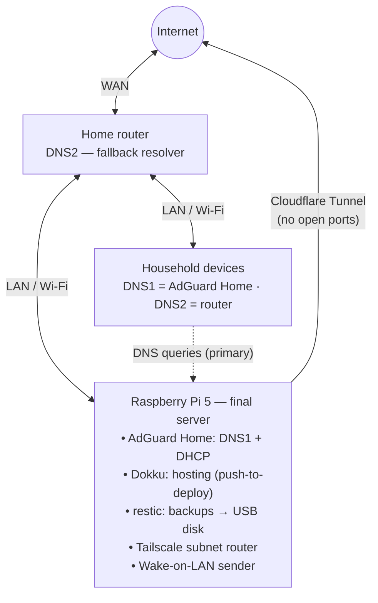
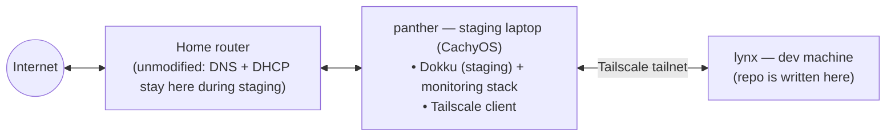

# Topology

This document describes the target topology of the lab, the current staging setup,
and the key design decision that fixes the original setup's single point of failure.

## Target topology (Raspberry Pi era)

All traffic to and from the internet flows through the router. The Raspberry Pi
provides DNS (AdGuard Home) and DHCP for the whole house, hosts services on Dokku,
and keeps them backed up with restic. Remote access is Tailscale only — the router
never opens a port. Cloudflare Tunnel publishes public services without exposing
the home IP.

## Current staging

The Raspberry Pi is not on-site yet. Until it arrives, every phase is validated on
**panther**, a CachyOS laptop that is always on and reachable over the tailnet:

During staging, the home network is untouched: the router keeps its normal DNS and
DHCP roles. Each phase keeps all of its state inside its own directory, so moving from
panther to the Raspberry Pi is *copy + re-run*, not archaeology.

## Key improvement: automatic DNS failover

The original setup had no answer to "AdGuard Home is down": AdGuard Home was the
only DNS handed out by DHCP, so if it died the whole house lost name resolution until
I fixed it. This design removes that single point of failure with automatic failover:

- AdGuard Home's DHCP advertises **AdGuard Home as DNS1** and **the router as DNS2**.
- If AdGuard Home dies, clients fail over to the router on their own. The household
  keeps internet — ads return until AdGuard Home is fixed, but nobody switches
  anything and nobody waits for the helpdesk.

**Trade-off (accepted):** some clients occasionally query the secondary resolver even
in normal operation, which leaks some ads. That is the documented cost of the design,
not a bug.

DNS/DHCP is only ever taken over from the router once the Raspberry Pi is on-site and
failover has been verified — see `network/` and `docs/runbooks/dhcp-migration.md`
(Phase 3).
## Origin story

The lab was first built and documented by hand in
[Reconstruyendo mi homelab: autohospedaje de cero](https://kcurtet.com/proyectos/homelab/)
(Spanish). That article is the origin story: AdGuard Home as house-wide DNS+DHCP, Tailscale +
Wake-on-LAN for remote access, Dokku apps published through a Cloudflare Tunnel,
and restic backups to an old USB disk.

This repo turns that setup into something anyone (including future me) can clone,
understand, and re-run on any Linux box with Docker — with a couple of design
improvements over the original (see [docs/topology.md](docs/topology.md)).

## Topology
